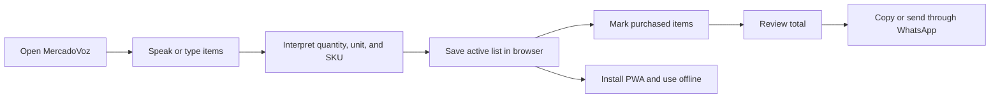
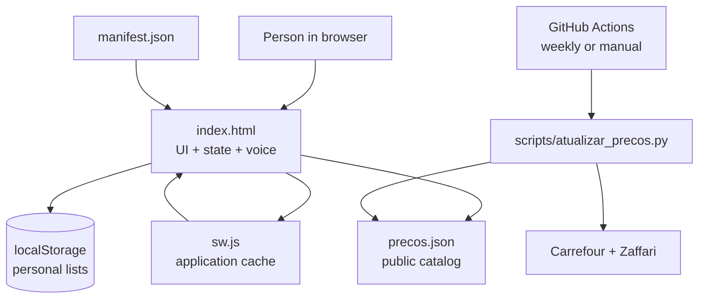
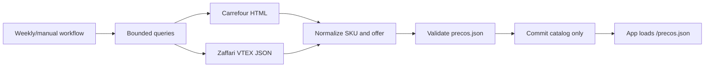

<p align="center">
  <a href="./README.md">Português</a> &nbsp;|&nbsp; <strong>English</strong>
</p>

<p align="center">
  
</p>

<p align="center">
  <strong>Say your list. Simplify your shopping.</strong><br />
  A fast, local-first Brazilian PWA that turns voice, catalog data, and price references into a clearer shopping run.
</p>

<p align="center">
  <a href="https://github.com/dtdias/mercadovoz-pwa/actions/workflows/atualizar_precos.yml"></a>
  
  
  
  
</p>

<p align="center">
  <a href="https://lista.trajano.dev.br">Open the app</a>
  &nbsp;·&nbsp;
  <a href="#quick-start">Quick start</a>
  &nbsp;·&nbsp;
  <a href="#architecture">Architecture</a>
  &nbsp;·&nbsp;
  <a href="#catalog-and-pricing">Catalog and pricing</a>
</p>

> MercadoVoz requires no login or external database. Lists stay in the user's browser; public catalog data is updated separately.

## Why it exists

Shopping lists begin in conversations, quick reminders, or a thought that appears in the store aisle. MercadoVoz removes that friction: speak naturally, review quickly, mark what is already in the cart, and share the result.

It is a **voice-assisted shopping list**, not a checkout. Prices are planning references, not guarantees of stock, final price, or regional availability.

## What it delivers

| Capture | Organize | Act |
| --- | --- | --- |
| Add items by voice or text, including quantities, units, and package sizes. | Keep multiple lists, mirror previous purchases, and track category totals. | Mark cart items, edit shelf prices, and send a formatted list through WhatsApp. |

### Flow



### Included capabilities

- `pt-BR` voice input with `SpeechRecognition`, interim transcripts, microphone permission handling, and actionable errors.
- Text input that splits multiple items by commas, line breaks, or the conjunction `e`.
- Spoken numbers, common units, and package-aware recognition such as `1kg`, `5kg`, `500ml`, and `1L`.
- Package-aware matching: different package sizes remain separate SKUs; the app never converts prices proportionally.
- Keyboard-friendly autocomplete with price references based on the selected criterion.
- Multiple lists with active-list selection, creation, mirroring, deletion, and clearing.
- `All`, `To buy`, and `In cart` filters, instant search, and quantity controls.
- List total, item count, cart value, and remaining value grouped by category.
- Editable shelf price, protected from future automatic criterion changes.
- WhatsApp export with status, quantities, partial values, and total.
- Optional sound feedback through `AudioContext`.
- Install suggestion on access, native prompt when available, and iOS/Safari instructions.
- Local-first behavior: lists in `localStorage`, catalog caching, and a Service Worker that never stores personal data.

## Architecture



`index.html` contains the interface, CSS, and Vanilla JavaScript. There is no frontend bundler, framework, or list API. The Service Worker uses network-first behavior for navigation and catalog data, plus cache-first behavior for static assets. Personal data never enters `SHELL_ASSETS`.

## Catalog and pricing

The catalog uses schema version `3`, with explicit identity fields to reduce package and comparison errors:

- `sku_key`: exact product, brand, family, and package identity.
- `comparison_key`: equivalence group used to compare brands.
- `package_amount`, `package_unit`, and `package_count`: package size and composition.
- `offers`: price, source, region, URL, and collection timestamp.
- `price_stats`: minimum, median, maximum, and offer count.

The interface provides three criteria: **Minimum**, **Median**, and **Maximum**. Median is selected by default. Changing the criterion recalculates only automatic prices in the active list. Manual prices and legacy items without an origin remain unchanged.

Source metadata stays in the catalog for auditing but is not shown on list items. Equivalent brands can share a comparison group without losing their original name, SKU, or package size.

### Catalog update flow



Configured sources live in [`scripts/fontes_precos.json`](scripts/fontes_precos.json). The scraper performs bounded public requests, tolerates source failures, and preserves the last valid catalog when a request fails.

## Stack

| Layer | Choice |
| --- | --- |
| Interface | Semantic HTML5, custom CSS, and Vanilla JavaScript |
| Voice | Web Speech API, `SpeechRecognition`, `pt-BR` locale |
| Personal state | Web Storage API, `mercadovoz_clean_v4` key |
| Catalog | Versioned JSON in `precos.json` |
| Automation | Python 3.10, Carrefour and Zaffari VTEX parsers |
| PWA | Web App Manifest, Service Worker, versioned cache |
| Sharing | WhatsApp through `wa.me` and Clipboard API |
| Deployment | Vercel, with a serverless icon endpoint |

## Quick start

### Requirements

- A modern browser with JavaScript enabled.
- `SpeechRecognition` is optional; text input remains available without voice support.
- Python 3.10+ for catalog automation and validation only.
- No `package.json`, npm dependencies, bundler, or test runner is configured.

### Run locally

```bash
python -m http.server 8080
```

Open `http://localhost:8080`. The static server is enough to inspect the interface and catalog. `/api/icon` depends on the Vercel runtime and is not exercised by this simple server.

### Update prices

```bash
python scripts/atualizar_precos.py
python scripts/atualizar_precos.py --check
```

`--no-scrape` only normalizes the existing catalog without querying sources. The default command can change generated prices; run it deliberately. Limits can be adjusted with `PRICE_MAX_QUERIES`, `PRICE_RESULTS_PER_QUERY`, `PRICE_TIMEOUT`, and `PRICE_DELAY`.

## Quality

Project-defined checks:

```bash
python -m json.tool manifest.json
python -m json.tool precos.json
python scripts/atualizar_precos.py --check
node -e "const fs=require('fs');const h=fs.readFileSync('index.html','utf8');new Function(h.slice(h.indexOf('<script>')+8,h.lastIndexOf('</script>')));"
node --check sw.js
```

Smoke checks cover package-aware matching, offer groups, manual-price preservation, install suggestion behavior, and duplicate ID/SKU detection.

## Privacy and operation

- Personal lists remain in browser `localStorage` and are never uploaded to a server.
- The Service Worker stores only the app shell, manifest, icons, and catalog.
- Clearing site data or changing browsers removes local lists; there is no cross-device synchronization.
- Voice support depends on browser policies; some environments require connectivity for recognition.
- Prices are public estimates and may change with time, region, ZIP code, stock, promotions, and source behavior.
- The scraper uses no login, CAPTCHA bypass, proxy, or private data.
- Manifest icons use [`api/icon.js`](api/icon.js), available in Vercel deployments.

## Documentation

- [`index.html`](index.html): interface, state, voice, matching, and installation.
- [`precos.json`](precos.json): generated catalog and collected offers.
- [`scripts/atualizar_precos.py`](scripts/atualizar_precos.py): normalization and price update logic.
- [`scripts/fontes_precos.json`](scripts/fontes_precos.json): configured sources and queries.
- [`manifest.json`](manifest.json): PWA metadata, icons, and shortcuts.
- [`sw.js`](sw.js): cache and offline strategy.
- [`AGENTS.md`](AGENTS.md): repository operating rules.

## Scope notes

- MercadoVoz does not check out, reserve products, or guarantee final pricing.
- There are no accounts, authentication, external databases, or list synchronization.
- Voice accuracy varies with browser, microphone, language, and connectivity.
- The catalog may contain products without a current offer; local prices remain editable in those cases.
- WhatsApp sharing opens an external flow; final sending depends on the device and installed app.

---

Built to turn a quick reminder into an organized shopping run.

Created by **Daniel Trajano Dias** · [`@dtdias`](https://github.com/dtdias)
