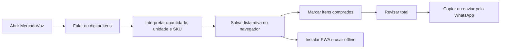
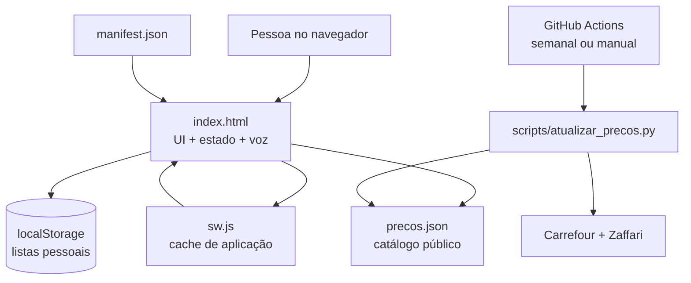
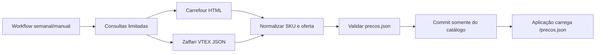

<p align="center">
  <strong>Português</strong> &nbsp;|&nbsp; <a href="./README.en.md">English</a>
</p>

<p align="center">
  
</p>

<p align="center">
  <strong>Fale sua lista. Simplifique suas compras.</strong><br />
  Um PWA brasileiro, rápido e local-first para transformar voz, catálogo e preços em uma compra mais organizada.
</p>

<p align="center">
  <a href="https://github.com/dtdias/mercadovoz-pwa/actions/workflows/atualizar_precos.yml"></a>
  
  
  
  
</p>

<p align="center">
  <a href="https://lista.trajano.dev.br">Abrir aplicação</a>
  &nbsp;·&nbsp;
  <a href="#início-rápido">Início rápido</a>
  &nbsp;·&nbsp;
  <a href="#arquitetura">Arquitetura</a>
  &nbsp;·&nbsp;
  <a href="#catálogo-e-preços">Catálogo e preços</a>
</p>

> O MercadoVoz não exige login nem banco externo. Listas permanecem no navegador do usuário; o catálogo público é atualizado separadamente.

## Por que existe

Lista de compras costuma nascer no meio de uma conversa, de uma lembrança no corredor ou de uma mensagem enviada no WhatsApp. MercadoVoz reduz esse atrito: fale naturalmente, revise rapidamente, marque o que já foi comprado e compartilhe o resultado.

É uma **lista de compras assistida por voz**, não um checkout. Preços servem como referência para planejamento, não como garantia de estoque, preço final ou disponibilidade regional.

## O que entrega

| Capturar | Organizar | Agir |
| --- | --- | --- |
| Adicione itens por voz ou texto, com quantidades, unidades e embalagens. | Mantenha várias listas, espelhe compras anteriores e acompanhe totais por categoria. | Marque itens no carrinho, edite preços da prateleira e envie lista formatada pelo WhatsApp. |

### Fluxo



### Capacidades incluídas

- Entrada por voz em `pt-BR` com `SpeechRecognition`, transcrição intermediária, permissão de microfone e mensagens de erro acionáveis.
- Entrada textual com separação de múltiplos itens por vírgula, quebra de linha ou conjunção `e`.
- Números falados por extenso, unidades comuns e reconhecimento de embalagens como `1kg`, `5kg`, `500ml` e `1L`.
- Matching package-aware: embalagens diferentes permanecem SKUs distintos; o aplicativo não divide preços proporcionalmente.
- Autocomplete com navegação por teclado e preço de referência conforme critério selecionado.
- Múltiplas listas, seleção de lista ativa, criação, espelhamento, exclusão e limpeza.
- Filtros `Todos`, `A comprar` e `No carrinho`, busca instantânea e controles de quantidade.
- Totais da lista, itens, valor no carrinho e valor pendente, agrupados por categoria.
- Preço manual editável no corredor do mercado, preservado contra futuras trocas do critério automático.
- Exportação para WhatsApp com status, quantidades, valores parciais e total.
- Feedback sonoro opcional via `AudioContext`.
- Sugestão de instalação ao acessar, prompt nativo quando disponível e instruções para iOS/Safari.
- Funcionamento local-first: listas no `localStorage`, catálogo em cache e Service Worker sem dados pessoais.

## Arquitetura



`index.html` concentra interface, CSS e JavaScript Vanilla. Não há bundler, framework de frontend ou API de listas. O Service Worker usa estratégia network-first para navegação e catálogo, além de cache-first para recursos estáticos. Dados pessoais nunca entram em `SHELL_ASSETS`.

## Catálogo e preços

Catálogo usa schema version `3`, com identidade explícita para reduzir erros de embalagem e comparação:

- `sku_key`: produto, marca, família e embalagem exatos.
- `comparison_key`: grupo de equivalência para comparação entre marcas.
- `package_amount`, `package_unit` e `package_count`: tamanho e composição da embalagem.
- `offers`: preços por fonte, região, URL e data de coleta.
- `price_stats`: mínimo, mediana, máximo e quantidade de ofertas.

Interface oferece três critérios: **Mínimo**, **Mediana** e **Máximo**. Mediana inicia selecionada. Mudança de critério recalcula somente preços automáticos da lista ativa. Preços editados manualmente e itens legados sem origem permanecem intactos.

Metadados de fonte continuam no catálogo para auditoria, mas não aparecem nos itens da lista. Marcas equivalentes podem compartilhar grupo de comparação sem perder nome, SKU ou tamanho original.

### Atualização do catálogo



Fontes configuradas vivem em [`scripts/fontes_precos.json`](scripts/fontes_precos.json). O scraper faz consultas públicas limitadas, tolera falhas por fonte e preserva o último catálogo válido quando uma consulta falha.

## Stack

| Camada | Escolha |
| --- | --- |
| Interface | HTML5 semântico, CSS próprio e JavaScript Vanilla |
| Voz | Web Speech API, `SpeechRecognition`, idioma `pt-BR` |
| Estado pessoal | Web Storage API, chave `mercadovoz_clean_v4` |
| Catálogo | JSON versionado em `precos.json` |
| Automação | Python 3.10, parsers Carrefour e Zaffari VTEX |
| PWA | Web App Manifest, Service Worker e cache versionado |
| Compartilhamento | WhatsApp via `wa.me` e Clipboard API |
| Deploy | Vercel, com endpoint serverless para ícones |

## Início rápido

### Requisitos

- Navegador moderno com JavaScript habilitado.
- `SpeechRecognition` é opcional; entrada textual continua disponível sem suporte de voz.
- Python 3.10+ apenas para automação e validação do catálogo.
- Não há `package.json`, dependências npm, bundler ou test runner configurados.

### Abrir localmente

```bash
python -m http.server 8080
```

Abra `http://localhost:8080`. O servidor estático permite revisar interface e catálogo. O endpoint `/api/icon` depende do runtime da Vercel e não é exercitado por esse servidor simples.

### Atualizar preços

```bash
python scripts/atualizar_precos.py
python scripts/atualizar_precos.py --check
```

`--no-scrape` somente normaliza o catálogo existente, sem consultar fontes. A execução padrão pode alterar preços gerados; use-a de forma consciente. Limites podem ser ajustados por `PRICE_MAX_QUERIES`, `PRICE_RESULTS_PER_QUERY`, `PRICE_TIMEOUT`, `PRICE_DELAY` e `PRICE_RETRIES`.

## Qualidade

Comandos definidos pelo projeto:

```bash
python -m json.tool manifest.json
python -m json.tool precos.json
python scripts/test_atualizar_precos.py
python scripts/atualizar_precos.py --check
node -e "const fs=require('fs');const h=fs.readFileSync('index.html','utf8');new Function(h.slice(h.indexOf('<script>')+8,h.lastIndexOf('</script>')));"
node --check sw.js
```

Smoke checks cobrem matching por embalagem, grupos de ofertas, preservação de preços manuais, sugestão de instalação e ausência de IDs/SKUs duplicados.

## Privacidade e operação

- Listas pessoais ficam no `localStorage` do navegador e não são enviadas para servidor.
- Service Worker armazena somente shell da aplicação, manifest, ícones e catálogo.
- Limpar dados do site ou trocar de navegador remove listas locais; não existe sincronização entre dispositivos.
- Voz depende das políticas e suporte do navegador; alguns ambientes exigem conexão para reconhecimento.
- Preços são estimativas públicas e podem mudar por horário, região, CEP, estoque, promoções e variação de fonte.
- Scraper não usa login, bypass de CAPTCHA, proxy ou dados privados.
- Ícones do manifest usam [`api/icon.js`](api/icon.js), disponível no deploy Vercel.

## Documentação

- [`index.html`](index.html): interface, estado, voz, matching e instalação.
- [`precos.json`](precos.json): catálogo gerado e ofertas coletadas.
- [`scripts/atualizar_precos.py`](scripts/atualizar_precos.py): normalização e atualização de preços.
- [`scripts/fontes_precos.json`](scripts/fontes_precos.json): fontes e consultas configuradas.
- [`manifest.json`](manifest.json): metadados, ícones e atalhos PWA.
- [`sw.js`](sw.js): cache e estratégia offline.
- [`AGENTS.md`](AGENTS.md): regras operacionais do repositório.

## Notas de escopo

- MercadoVoz não faz checkout, reserva produtos ou confirma preço final.
- Não há conta, autenticação, banco externo ou sincronização de listas.
- Precisão da voz varia por navegador, microfone, idioma e conexão.
- Catálogo pode conter produtos sem oferta atual; nesses casos, preço local permanece ajustável.
- Compartilhamento WhatsApp abre o fluxo externo; envio final depende do aplicativo e do dispositivo.

---

Feito para transformar uma lembrança rápida em compra organizada.

Desenvolvido por **Daniel Trajano Dias** · [`@dtdias`](https://github.com/dtdias)
